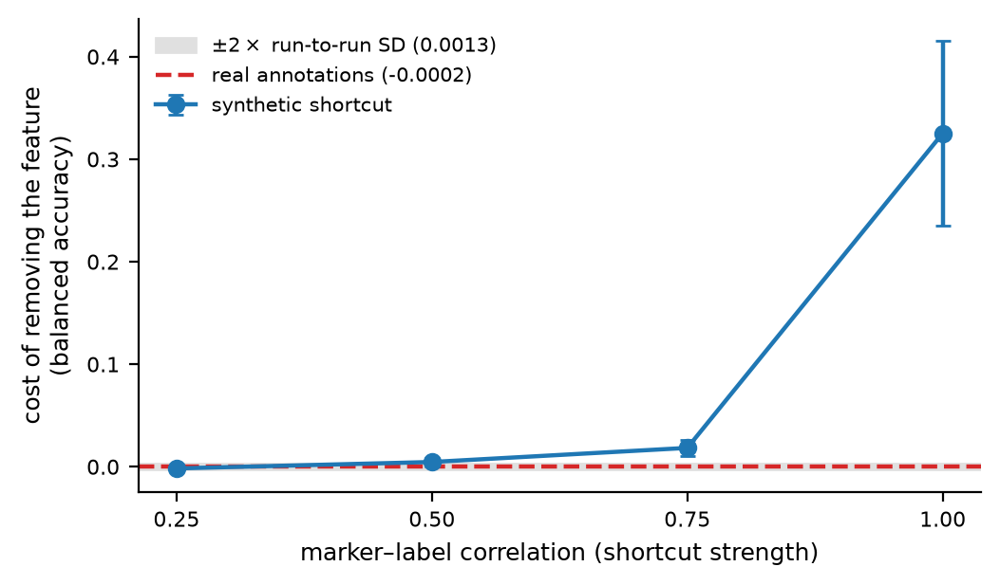
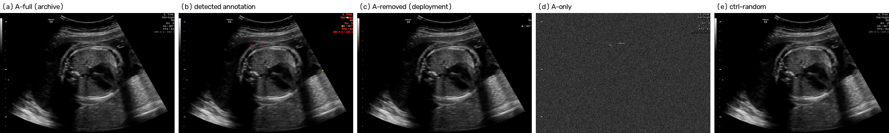

# Available but Not Taken

Code, results and figures for:

> **Available but Not Taken: Burnt-In Annotations Can Carry Label Information
> That Archive-Trained Ultrasound Classifiers Do Not Use**

Clinical ultrasound archives are annotation-rich — sonographers freeze the
image, place calipers, and burn measurements and vendor text into the pixels.
Models are trained on those archives and deployed on live, un-annotated
scanning. It has been suggested that this inflates reported performance.

**We tested it. In these datasets, it doesn't.** And because a null is only worth
reading if the experiment could have found something, we calibrate the design's
sensitivity by planting a cue of known strength and sweeping how strongly it
predicts the label.

---

## The result in four numbers

| | value |
|---|---|
| Cost of removing every detected annotation (FETAL_PLANES_DB) | **-0.0002** balanced accuracy |
| Paired-difference SD of that contrast | 0.0013 |
| Equivalence within ±0.005 (TOST) | **p = 0.0002** |
| Cost of removing an *adopted* synthetic cue (ρ = 1.0) | **+0.3253** |
| Smallest removal cost this design detects | between +0.0046 and +0.0184 |

The design detects a cue once its label correlation reaches ρ = 0.75
(removal cost +0.0184, Holm-adjusted p = 0.007) and does not
resolve one at ρ ≤ 0.5. We report that interval rather than a
ratio against the observed effect: dividing by a quantity argued to be equivalent
to zero gives a number governed by rounding, not by the experiment.

<p align="center">
  <br>
  <em>Cost of removing a feature, against how reliably it predicts the label.
  The real annotations (dashed) sit on the noise floor; a synthetic shortcut of
  identical area and intensity is detected easily once it becomes a near-perfect
  predictor.</em>
</p>

Two findings explain the null rather than restating it:

- **The cue can be available, and is still not taken.** A classifier trained on
  annotation pixels alone reaches **0.5945** on 6-class fetal plane
  classification against 0.167 chance (3.6×). On BUS-BRA — 84% annotated — the
  same experiment returns **0.5036**, exactly chance, because calipers mark
  *where* a lesion is, not *what* it is. Annotation density does not predict
  annotation–label information.
- **Adoption has a sharp threshold.** Dropping the synthetic shortcut's
  reliability from 1.0 to 0.75 collapses its removal cost from +0.3253 to
  +0.0184. Anatomy already delivers 0.957, so anything less than a near-perfect
  cue is simply not worth learning.

---

## The experimental design

For every image we build an **annotation triplet** plus a control:

| variant | what it is |
|---|---|
| `a_full` | the original image — what archives contain |
| `a_removed` | annotations detected and inpainted — what deployment looks like |
| `a_only` | annotation regions kept, anatomy replaced by speckle-matched noise |
| `ctrl_random` | an **equal area of anatomy** inpainted instead |

`ctrl_random` is the refutation control: if erasing anatomy costs as much as
erasing annotations, any measured drop is about pixel removal, not annotations.
It is why the raw null alone was not enough, and why the positive control exists.



---

## Reproducing

Four public datasets are used: FETAL_PLANES_DB, HC18, BUS-BRA and MMOTU-2D. We
**do not redistribute them** — each carries its own licence and must be obtained
from its authors. See [`docs/DATASETS.md`](docs/DATASETS.md).

```bash
python -m venv .venv && .venv/bin/pip install -e . -r requirements.txt

# Stage A/B -- CPU, ~15 min for all four datasets.
# Detects annotation masks at native resolution and packs the variants.
python -m asa manifest --dataset fetal_planes
python -m asa masks    --dataset fetal_planes --workers 10
python -m asa mi       --dataset fetal_planes      # annotation-label information
python -m asa package  --dataset fetal_planes --size 224

# Stage C -- GPU. See docs/KAGGLE_RUNBOOK.md for the hosted-notebook route.
python -m asa matrix --experiment step4_gate              --dataset fetal_planes
python -m asa matrix --experiment step4b_available_vs_taken --dataset fetal_planes
python -m asa matrix --experiment step4c_positive_control  --dataset fetal_planes --synthetic-strength 1.0
```

Dataset paths are set in `configs/datasets/*.yaml`. Everything else is
config-driven, so a run is reproducible from its config alone.

### Regenerating every number in the paper

```bash
python scripts/analyse_matrix.py results/step4_gate/fetal_planes
python scripts/make_results_assets.py --paper <manuscript-dir>
python scripts/make_qualitative_figures.py --out figures/
```

No figure in the paper is transcribed by hand: tables are `\input` and inline
numbers are generated LaTeX macros.

---

## Layout

```
src/asa/
  annot/       annotation detection, variant construction, OCR content parsing
  data/        dataset readers, patient-level splitting, variant packaging,
               synthetic-shortcut injection
  models/      backbones and heads (no new architecture is proposed)
  train/       training engine, the train x test matrix, the pre-registered gate
  eval/        metrics, empirical chance rates, calibration, patient-level
               bootstrap, paired tests, mutual information, saliency
configs/       one YAML per dataset and per experiment
scripts/       analysis and figure generation
results/       all run outputs: per-cell metrics, bootstrap CIs, per-image
               predictions, split logs, provenance stamps
figures/       every figure in the paper and supplementary
tests/         15 tests covering the invariants the results depend on
docs/          dataset acquisition, Kaggle runbook
```

## Design decisions worth knowing

- **Masks never depend on OCR.** OCR reads annotation *content* for one
  experiment; the mask itself comes from geometry and morphology, so no headline
  number is bounded by OCR recall.
- **No absolute intensity thresholds.** The same class of burnt-in glyph
  measures 170, 209 and 49 grey levels across these datasets. Detection uses
  top-hat contrast plus an edge-sharpness ratio, which are brightness-invariant.
- **Colour Doppler is not annotation.** It is chromatic but it is imaging data;
  inpainting it would destroy the measurement. It is detected and withheld.
- **Balanced accuracy is the primary metric**, whose chance level is exactly
  1/K irrespective of prevalence. The empirical class distribution is used where
  it matters — macro-F1 and the regression reference.
- **Bootstrap resamples patients, not images.** Frames from one subject are not
  independent observations.
- **Splits are patient-level throughout**, with leakage assertions that fail loudly.

## Limitations

- The deployment shift is **simulated** by inpainting, not observed on paired
  frozen/live frames from the same examination.
- Mask verification by two independent human raters was **not completed**; the
  automatic suspect-mask rate is reported instead.
- Only ResNet-50/ImageNet was run. Foundation encoders are supported by the code
  but untested.
- Four datasets are **characterised**; classification experiments are reported
  for **two** (FETAL_PLANES_DB and BUS-BRA, 14,275 images). One architecture,
  one resolution (224×224). Annotation conventions are institution-specific;
  the pipeline is released so the question can be re-asked elsewhere.
- The synthetic cue used for calibration is a solid rectangle whose *position*
  encodes the class — easier to read than a glyph string, so the sweep bounds
  sensitivity from above. A learnability-matched glyph cue is implemented
  (`--synthetic-cue glyph`) but its sweep is not yet reported.

## Citation

See [`CITATION.cff`](CITATION.cff).

## Licence

Code released under the MIT Licence ([`LICENSE`](LICENSE)). The datasets are not
redistributed and remain under their original terms.
